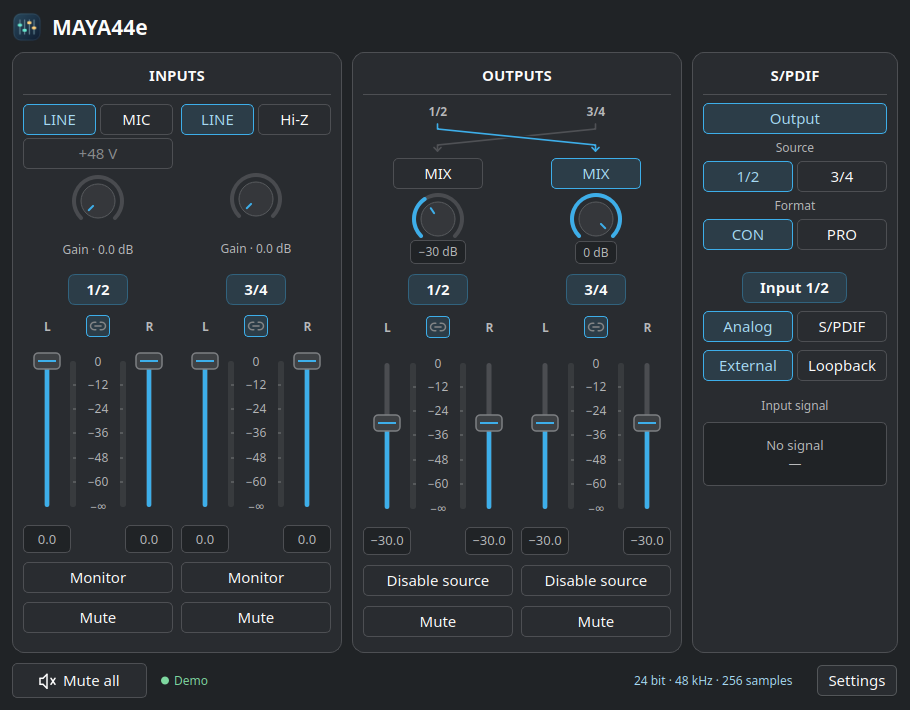

# MAYA44 Linux

Experimental Linux ALSA driver and Qt 6 mixer for ESI MAYA44 PCIe cards.
The mixer runs in the Plasma system tray on Wayland and has English and Russian
translations, light and dark themes, live meters, and analog and S/PDIF controls.



## Hardware status

| Card | PCI subsystem ID | Status |
| --- | --- | --- |
| MAYA44e | `0e51:0001` | Tested on one card for analog playback, four-channel capture, duplex, MIX and suspend/resume |
| MAYA44 XTe | `0e51:0002` | Experimental. Hardware testing pending |
| MAYA44 eX | `0e51:0003` | Experimental. Hardware testing pending |

The driver targets these three PCIe models, all with PCI device ID
`19fe:7000`. Capture tests checked stream continuity with unconnected analog
inputs. Testing with a known analog input signal is still pending.

From alpha.5, playback and capture use four-channel `S32_LE` with 24
significant bits and share a sample clock. Direct ALSA clients can use
`RW_INTERLEAVED` or `MMAP_COMPLEX`. Use PipeWire or the ALSA `plughw` device
for sample format conversion. The mixer offers 44.1, 48, 88.2 and 96 kHz and
period sizes of 64, 128, 256, 512 or 1024 frames. The hardware buffer holds
two periods. S/PDIF capture is unavailable at 88.2 kHz.

The analog-only [MAYA44e RFC v5](https://lore.kernel.org/r/20261120-codex-alsa-maya44e-v5-1-49f3682dfc81@proton.me)
was submitted to the Linux sound mailing list. It uses the proposed ALSA PCM
reset operation. The GitHub packages use the PCM interface in stock Kubuntu
kernels.

## Install the Kubuntu packages

Download the matching pair of `.deb` files from
[GitHub Releases](https://github.com/Nsch11/maya44-linux/releases).
These packages target Kubuntu 26.04 on amd64. Open a terminal in the download
directory and run the following commands.

```sh
sudo apt install "linux-headers-$(uname -r)"
sudo apt install "$PWD"/maya44e-dkms_*_amd64.deb "$PWD"/maya44e-mixer_*_all.deb
```

If you previously installed the driver through `packaging/install.py`, run
`sudo maya44e-install remove` before installing the packages. This preserves
the saved ALSA state and leaves the running module loaded. Reboot after
installing or upgrading the driver to load the new build.

Start **MAYA44 Mixer** from the application menu or run
`maya44e-mixer --show`. If the mixer from a source checkout is already
running, quit it from the tray before launching the packaged mixer.
To start it in the tray at login, copy the example
`/usr/share/doc/maya44e-mixer/examples/maya44e-mixer.desktop` into
`~/.config/autostart/`. If a user autostart entry already launches
the source checkout, replace that entry with the packaged one.

Install newer `.deb` files with the same `apt install` command to
upgrade. DKMS rebuilds the module for kernel updates with matching
headers. Ubuntu may prompt you to enroll a Machine Owner Key to load
the module with Secure Boot enabled.

Check the installed versions with `dpkg -l maya44e-dkms maya44e-mixer`
and the module builds with `dkms status -m maya44e`. To remove both
packages, run `sudo apt remove maya44e-dkms maya44e-mixer`. Reboot
to unload the running driver.

To build the two packages locally on amd64, run
`dpkg-buildpackage --build=binary -us -uc` with `dpkg-dev` and `make` installed.
The resulting files are placed in the parent directory.

## Install the experimental driver from source

The standalone DKMS installer targets Debian and Ubuntu systems with systemd
and x86-64. Use it on a system without the `maya44e-dkms` package.
The packaged driver was tested on Kubuntu 26.04 with Linux 7.0 kernels.
Install matching kernel headers for every kernel you want DKMS to build for.
The installer stops if `mokutil` reports that Secure Boot is enabled.

```sh
sudo apt install build-essential dkms "linux-headers-$(uname -r)" alsa-utils
sudo /usr/bin/python3 packaging/install.py install --kernel "$(uname -r)"
```

Reboot to start using the installed module. DKMS can rebuild it after kernel
updates when matching headers are installed. To see the installation state
or remove the driver from disk, use the commands below. After removal, reboot
to unload the running module.

```sh
maya44e-install status
sudo maya44e-install remove
```

To compile the module without installing it, run `make -C kernel`.

## Run the mixer

```sh
sudo apt install python3-pyqt6 qt6-wayland qt6-svg-plugins alsa-utils pipewire-bin pulseaudio-utils
/usr/bin/python3 panel/maya44e.py --show
```

Run the mixer as your desktop user. Use `--tray` for a tray-only launch,
`--demo` to preview the interface without a card, and `--card MAYA44eX`
(or another ALSA card ID) to select one of multiple supported cards.
For Plasma autostart, add the executable `panel/maya44e.py` from your
checkout in System Settings → Autostart. It starts in the tray by default.
The mixer uses the controls exposed by the experimental DKMS driver.

## Optional stereo outputs for PipeWire

WirePlumber 0.5 can expose output pairs 1/2 and 3/4 as separate stereo devices.
In Plasma, select the card's multichannel duplex profile and install the
matching rule and script as your desktop user. The mixer package installs
copies in `/usr/share/maya44e-mixer/wireplumber/`. In the commands below,
use that directory as `policy_dir` when installing from the package.

```sh
config_dir="${XDG_CONFIG_HOME:-$HOME/.config}/wireplumber/wireplumber.conf.d"
scripts_dir="${XDG_DATA_HOME:-$HOME/.local/share}/wireplumber/scripts"
policy_dir=config
install -Dm644 "$policy_dir/53-maya44e-stereo.conf" "$config_dir/53-maya44e-stereo.conf"
install -Dm644 "$policy_dir/maya44e-stereo.lua" "$scripts_dir/maya44e-stereo.lua"
systemctl --user restart wireplumber
```

The restart briefly interrupts audio. Remove those two files and restart
WirePlumber again to restore the single four-channel output. Hardware MIX
works independently of the two stereo devices.

## Known limits and test reports

- S/PDIF internal loopback was tested on the MAYA44e. External S/PDIF
  input and output are awaiting hardware testing.
- On the tested MAYA44e, a faint whine was audible in the left channel of
  output 3/4 under both Linux and Windows. It was much less noticeable at
  88.2 or 96 kHz.
- If you hear dropouts at small periods, try 512 frames as a baseline.
- If you test an XTe or eX, please include the PCI subsystem ID
  (`lspci -nnv -d 19fe:7000`), kernel version, sample rate, period size, and
  which inputs, outputs or suspend modes you tested.

## License and credits

Project by **Nordschamane**. Driver code is [GPL-2.0-only](LICENSES/GPL-2.0-only.txt).
The mixer and installer are [GPL-3.0-or-later](panel/COPYING.txt).
See [code provenance and third-party credits](docs/PROVENANCE.md).
