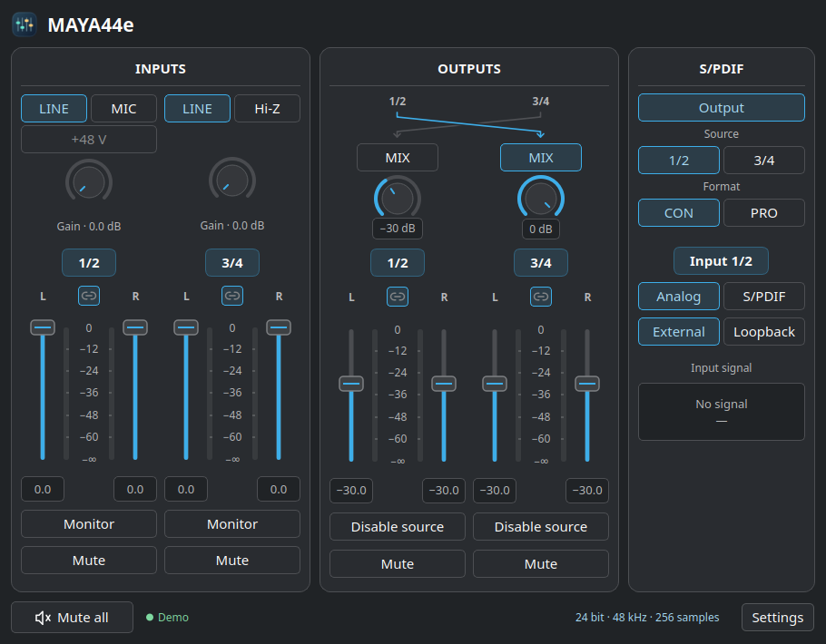

# MAYA44 Linux

Experimental Linux ALSA driver and Qt 6 mixer for ESI MAYA44 PCIe cards.
The mixer runs in the Plasma system tray on Wayland and has English and Russian
translations, light and dark themes, live meters, and analog and S/PDIF controls.



## Hardware status

| Card | PCI subsystem ID | Status |
| --- | --- | --- |
| MAYA44e | `0e51:0001` | Analog playback, capture, duplex, MIX and suspend/resume exercised on one card |
| MAYA44 XTe | `0e51:0002` | Experimental profile. Hardware testing wanted |
| MAYA44 eX | `0e51:0003` | Experimental profile. Hardware testing wanted |

All three profiles match PCI device `19fe:7000` and use the same driver. The PCI
MAYA44 and the MAYA44 USB are different devices.

Both directions use four-channel ALSA PCM with a shared sample clock. PCM
formats are `S16_LE`, `S24_3LE`, `S24_LE` and `S32_LE`. The last format
has 24 significant bits. The mixer offers 44.1, 48, 88.2 and 96 kHz and period
sizes of 64, 128, 256, 512 or 1024 frames. The hardware PCM buffer uses two
periods.

## Install the experimental driver

The DKMS installer targets Debian and Ubuntu systems with systemd and x86-64.
The driver was developed and tested on Kubuntu with Linux 7.0 kernels.
Install matching kernel headers for every kernel you want DKMS to build for.
The installer stops if `mokutil` reports that Secure Boot is enabled.

```sh
sudo apt install build-essential dkms "linux-headers-$(uname -r)" alsa-utils
sudo /usr/bin/python3 packaging/install.py install --kernel "$(uname -r)"
```

Reboot to start using the installed module. DKMS can rebuild it after kernel
updates when matching headers are installed. To see the installation state
or remove the driver from disk, use the commands below. After removal, reboot
to unload the running module.

```sh
maya44e-install status
sudo maya44e-install remove
```

To compile the module without installing it, run `make -C kernel`.

## Run the mixer

```sh
sudo apt install python3-pyqt6 qt6-wayland qt6-svg-plugins alsa-utils
/usr/bin/python3 panel/maya44e.py --show
```

Run the mixer as your desktop user. Use `--tray` for a tray-only launch,
`--demo` to preview the interface without a card, and `--card MAYA44eX`
(or another ALSA card ID) to select one of multiple supported cards.
For Plasma autostart, add the executable `panel/maya44e.py` from your
checkout in System Settings → Autostart. It starts in the tray by default.
The mixer uses the controls exposed by the experimental DKMS driver.

## Optional stereo outputs for PipeWire

WirePlumber 0.5 can expose output pairs 1/2 and 3/4 as separate stereo devices.
In Plasma, select the card's multichannel duplex profile and install the
matching rule and script as your desktop user.

```sh
config_dir="${XDG_CONFIG_HOME:-$HOME/.config}/wireplumber/wireplumber.conf.d"
scripts_dir="${XDG_DATA_HOME:-$HOME/.local/share}/wireplumber/scripts"
install -Dm644 config/53-maya44e-stereo.conf "$config_dir/53-maya44e-stereo.conf"
install -Dm644 config/maya44e-stereo.lua "$scripts_dir/maya44e-stereo.lua"
systemctl --user restart wireplumber
```

The restart briefly interrupts audio. Remove those two files and restart
WirePlumber again to restore the single four-channel output. Hardware MIX
works independently of the two stereo devices.

## Known limits and test reports

- External S/PDIF is awaiting hardware testing. The internal loopback was tested.
- One MAYA44e had a faint left-channel whine on output 3/4 under both Linux
  and Windows. The owner found it much less audible at 88.2 or 96 kHz.
- If you hear dropouts at small periods, try 512 frames as a baseline.
- Reports from XTe and eX owners are welcome. Include the card's PCI ID
  (`lspci -nn -d 19fe:7000`), kernel version, sample rate, period size, and
  the specific outputs, inputs or sleep modes you exercised.

## License and credits

Project by **Nordschamane**. Driver code is [GPL-2.0-only](LICENSES/GPL-2.0-only.txt).
The mixer and installer are [GPL-3.0-or-later](panel/COPYING.txt).
See [code provenance and third-party credits](docs/PROVENANCE.md).
